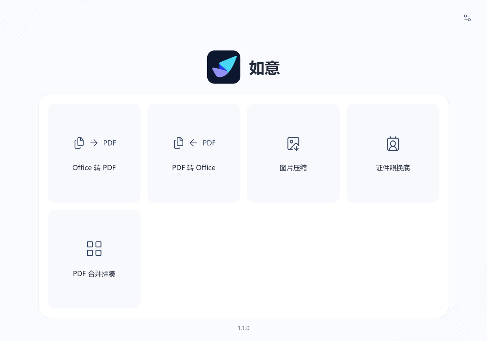

# 如意 · 一站式文件处理工具箱

基于 Python 的 Windows 桌面工具，将 Office / PDF 转换、图片压缩、证件照换底与 PDF 整理拼版集中在一个界面。



上图为 1.1.0 源码生成的主页预览（2026-11-05），不含私人文件。当前公开代码对应 2026-11-07 的 1.1.0 修订；公开整理未更改转换逻辑或版本号。

## 功能

| 模块 | 主要能力 |
| --- | --- |
| Office 转 PDF | DOC/DOCX、XLS/XLSX、PPT/PPTX；调用本机可用的 WPS、Microsoft Office 或 LibreOffice |
| PDF 转 Office | 输出 DOCX、XLSX、PPTX；按文字、表格、图像及矢量信息尽力重建，保留可编辑对象 |
| 图片压缩 | JPG、PNG、WebP；格式、画质、像素与目标体积；同格式同尺寸时避免输出反而变大 |
| 证件照换底 | 本地 MODNet 人像抠图；12 种预设背景，包含渐变，支持自定义颜色 |
| PDF 合并拼凑 | 多文件整理、拖拽重排、提取/拆分/复制/旋转、50 步撤销重做、2/4/6/9 宫格、小册子、长页与规则预设 |

另有页码、文字水印、图片印章、PDF 背景、文件多选批处理、浅深色主题和桌面快捷方式入口。

## 下载与使用

在本仓库 **Releases** 下载 Windows x64 ZIP，完整解压后运行“如意.exe”。若 Releases 尚无附件，先按下面的方法运行源码。Windows EXE 不支持 macOS。

Office 转 PDF 需要另外安装对应办公软件；程序不捆绑或授权 WPS、Microsoft Office、LibreOffice。生成效果与所选引擎、字体及源文件有关。

## 从源码运行

推荐 Windows 11、64 位 Python 3.12（含 Tcl/Tk）。在仓库根目录打开 PowerShell：

```powershell
py -3.12 -m venv .venv
.\.venv\Scripts\python.exe -m pip install -r requirements.txt
.\.venv\Scripts\python.exe app.py
```

若没有 `py` 启动器，用 Python 3.12 可执行文件的完整路径替换首条命令中的 `py -3.12`。照片模块首次使用会从固定来源下载约 26 MB 模型；转换与人像推理在本机执行，程序不上传源文档或照片。[模型来源与离线配置](docs/MODEL.md)。

```powershell
.\.venv\Scripts\python.exe -m unittest discover -s tests -v
```

公开测试使用代码生成的合成 PDF 和图片，不需要私人样例、办公软件或联网下载模型。[打包说明](docs/BUILD.md)。

## 代表性迭代与验证

- **复杂文档：**持续修正表格缺字、跨页表格对齐、目录误图片化、公式与正文边界及图片重复。正文和普通表格优先保持可编辑；复杂公式允许局部图像保真。
- **文件体积：**在一份 110 页指定样例中，DOCX 从 24.12 MB 降至 6.45 MB（约 73.3%）；138 张图片的像素尺寸和 501 项几何数据不变，150 dpi 全篇平均绝对灰度差为 0.02264。
- **页面整理：**100 页、3 个来源的流程，经重排、删 5 页及旋转 2 页后导出 95 页，页序与方案一致且原件哈希未变；20 页四合一输出 5 页。
- **验证范围：**1.1.0 阶段性完整回归通过 154 项。它是历史开发验收记录；本仓库 `tests/` 是可公开复现的合成样例测试子集，不把两者计数混在一起。

指定样例的结果不代表所有 PDF 的准确率或性能。指标、测试层级与限制见 [质量验证](docs/QUALITY.md)。

## 实现与协作

- **桌面与交付：**Python、Tkinter、Pillow、PyInstaller。
- **文档：**pdfplumber / PDFium 分析与渲染；python-docx、openpyxl、python-pptx 写出；pypdf 与 ReportLab 处理整理和叠加。
- **人像：**MODNet FP32 ONNX、ONNX Runtime；模型按原有许可证使用，不属于本项目自行训练的模型。
- **研发方式：**项目发起人负责需求、功能规划、交互方向、真实样例测试和版本验收；Codex、DeepSeek Harness 等工具辅助实现、排查和自动化检查。软件运行本身不需要大模型 API。[架构与产品决策](docs/ARCHITECTURE.md)。

## 已知边界

PDF 缺少原 Word 的部分语义信息，复杂文档在视觉保真与连续编辑之间存在取舍，不承诺任意 PDF 完全可编辑地 1:1 还原。扫描页及原稿内图片表格不自动获得 OCR 文字。部分公式保持局部图片。PDF 多页拼版遇交互表单、内部跳转或会被裁断的注释时会明确拒绝，避免静默破坏内容。

当前 Windows 下载包没有代码签名；来源校验值不能替代签名，也不保证绕过 Windows 智能应用控制。macOS 适配及代码签名尚未交付。

## 文档与许可

[功能与使用](docs/USAGE.md) · [架构](docs/ARCHITECTURE.md) · [验证](docs/QUALITY.md) · [迭代记录](docs/CHANGELOG.md) · [贡献](CONTRIBUTING.md)

项目自有代码以 [MIT](LICENSE) 许可开放。依赖、模型、图标组件等分别遵循其原有许可，详见 [第三方声明](THIRD_PARTY_NOTICES.md)。
